# Sweety – Blood Glucose Tracker

Sweety is a small web app where a person with diabetes records up to **4 blood glucose readings a day** and views **daily, month-to-date and monthly reports**.

**Stack:** Node.js + Express 5 (TypeScript) · PostgreSQL 16 · React 19 + Vite (TypeScript) · Vitest, Supertest and React Testing Library · Docker Compose

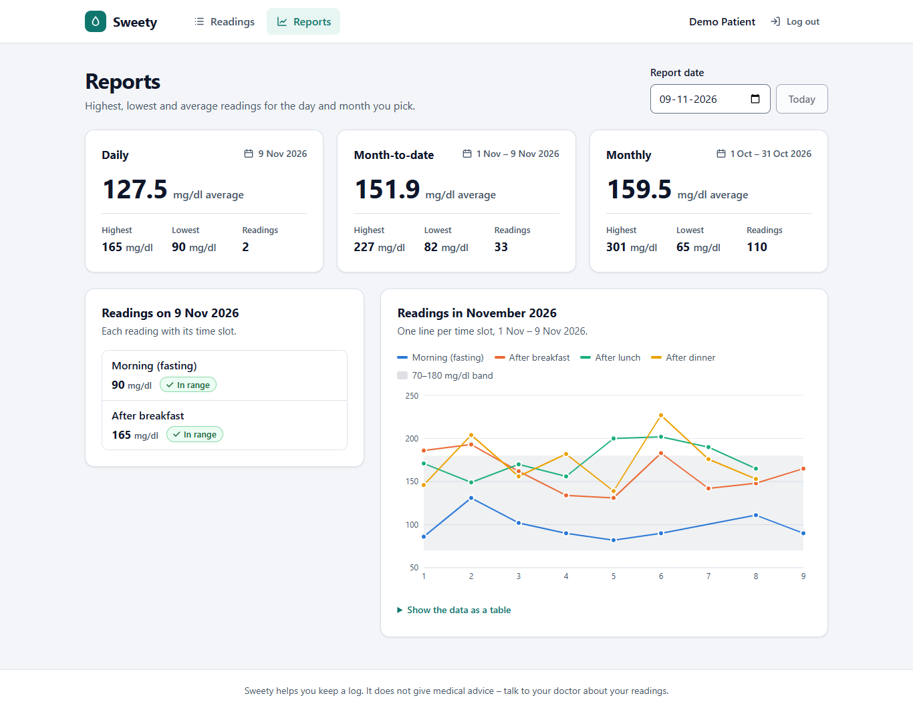

---

## Contents

- [Features](#features)
- [Quick start with Docker](#quick-start-with-docker-whole-app)
- [Local development setup](#local-development-setup)
- [Running the tests](#running-the-tests)
- [API reference](#api-reference)
- [Project structure](#project-structure)
- [Screenshots](#screenshots)
- [Notes: assumptions and future improvements](#notes)

---

## Features

### Required

| Feature | Details |
| --- | --- |
| Sign up and log in | Name, email and password. Passwords are hashed with **bcrypt** (cost 10) and never stored as plain text. Login returns a JWT. |
| Private data | Every reading and report query is filtered by the logged-in user's id. Someone else's reading gets a `404`. |
| Add, view, edit, delete readings | Each reading has a date, a time slot (Morning (fasting), After breakfast, After lunch, After dinner) and a value in mg/dl. |
| Validation | Each rule is checked in the browser **and** again in the API, with the same messages (see table below). |
| Reports | Daily, month-to-date and previous month: highest, lowest, average (1 decimal) and number of readings. A friendly empty state when there is no data. The daily report lists each reading with its slot. |

**Validation rules**

| Rule | Message shown |
| --- | --- |
| Value is required | "Please enter a glucose value." |
| Whole number between 40 and 600 | "Value must be between 40 and 600 mg/dl." (decimals: "Value must be a whole number between 40 and 600 mg/dl.") |
| One reading per slot per day | "You already have an After lunch reading for this date." |
| Maximum 4 readings per day | "You can add only 4 readings per day." |
| Date cannot be in the future | "Date cannot be in the future." |

The "one per slot per day" rule is also a `UNIQUE (user_id, reading_date, slot)` constraint in PostgreSQL, so it holds even if two requests arrive at the same moment.

### Bonus tasks done

- **Pagination:** `GET /api/readings?page=1&limit=20`, with Previous/Next controls in the UI.
- **Chart:** a Recharts line chart of the selected month, with one line per time slot, a tooltip, a legend and a "show as table" option.
- **Docker:** `docker-compose.yml` starts PostgreSQL, the API and the client (nginx).
- **Frontend tests:** React Testing Library tests for the reading form.

### Other details

- Responsive layout for phones, tablets and desktops. Colours meet WCAG AA contrast, with automatic light and dark themes.
- Keyboard and screen-reader friendly: labelled fields, errors linked to their inputs, the reading form moves focus to the first invalid field, an accessible delete dialog and a skip link.
- "Today" progress card that shows which of today's 4 slots are already logged.
- Readings are labelled Low / In range / High (below 70, 70–180, above 180 mg/dl). This is for display only and is not medical advice.

---

## Quick start with Docker (whole app)

Requirements: [Docker Desktop](https://www.docker.com/products/docker-desktop/).

```bash
docker compose up --build -d                  # PostgreSQL + API + client
docker compose exec server npm run seed:prod  # optional: demo user with sample data
```

Open **http://localhost:8080** and log in with **`demo@sweety.app` / `Demo@1234`**.

The API container applies database migrations every time it starts. To stop everything, run `docker compose down`. Add `-v` to also delete the database volume.

---

## Local development setup

### 1. Prerequisites

- **Node.js 20 or newer** (built and tested on Node 22)
- **PostgreSQL 14 or newer**, either through Docker (easiest) or installed locally

### 2. Install dependencies

```bash
npm run install:all        # same as: npm install --prefix server && npm install --prefix client
```

### 3. Set up the database

**Option A: Docker (recommended).** This starts only PostgreSQL, on port **5434**:

```bash
docker compose up -d db
```

On first start it creates two databases: `sweety` (the app) and `sweety_test` (used by the automated tests). The user and password are both `sweety`.

**Option B: a local PostgreSQL install.** Run this in `psql` as a superuser:

```sql
CREATE USER sweety WITH PASSWORD 'sweety';
CREATE DATABASE sweety OWNER sweety;
CREATE DATABASE sweety_test OWNER sweety;
```

Then change the port in `DATABASE_URL` and `TEST_DATABASE_URL` (step 4) from `5434` to your port, usually `5432`.

### 4. Environment variables

```bash
cp server/.env.example server/.env    # required: then set JWT_SECRET to a long random string
cp client/.env.example client/.env    # optional: the defaults already work
```

| File | Variable | Purpose |
| --- | --- | --- |
| `server/.env` | `PORT` | API port (default `4000`) |
| | `DATABASE_URL` | Main database connection string |
| | `TEST_DATABASE_URL` | Test database. Its name **must end with `_test`**, because tests wipe it. |
| | `JWT_SECRET` | Secret for signing login tokens (16+ characters) |
| | `JWT_EXPIRES_IN` | How long a login lasts (default `7d`) |
| | `CORS_ORIGIN` | Allowed browser origin(s) |
| | `APP_TIMEZONE` | Timezone that decides what "today" is (default `Asia/Kolkata`) |
| | `BCRYPT_SALT_ROUNDS` | bcrypt cost factor (default `10`) |
| `client/.env` | `VITE_API_URL` | Base URL for API calls (default `/api`) |
| | `VITE_API_PROXY_TARGET` | Where the Vite dev server forwards `/api` (default `http://localhost:4000`) |
| | `CLIENT_PORT` | Vite dev server port (default `5180`) |
| `.env` (root, optional) | `DB_PORT`, `WEB_PORT`, `JWT_SECRET`, `JWT_EXPIRES_IN`, `APP_TIMEZONE` | Settings for `docker-compose.yml` |

To generate a secret: `node -e "console.log(require('crypto').randomBytes(32).toString('hex'))"`

### 5. Create the tables and the demo data

```bash
npm run migrate     # applies server/migrations/*.sql (safe to run again)
npm run seed        # demo@sweety.app / Demo@1234 with readings from the 1st of last month to today
```

Running the seed script again rebuilds the demo user from scratch.

### 6. Run the server and the client

Use two terminals:

```bash
npm run dev:server   # API on http://localhost:4000 (restarts on file changes)
npm run dev:client   # app on http://localhost:5180 (forwards /api to the API)
```

Open **http://localhost:5180**.

Production build: `npm run build --prefix server && npm start --prefix server`, and `npm run build --prefix client` (the output goes to `client/dist`).

| Service | URL / port |
| --- | --- |
| Client (dev) | http://localhost:5180 |
| API (dev) | http://localhost:4000/api |
| PostgreSQL (Docker) | localhost:5434 |
| Full app (Docker) | http://localhost:8080 |

---

## Running the tests

```bash
docker compose up -d db   # the server tests need the sweety_test database
npm test                  # server tests, then client tests
```

Or run each part on its own:

```bash
npm test --prefix server  # 58 tests: unit + API integration (Vitest + Supertest, real PostgreSQL)
npm test --prefix client  # 16 tests: ReadingForm with React Testing Library + helper unit tests
npm run typecheck         # TypeScript checks for both projects
```

What the tests cover:

- **Server unit tests:** reading validation (every rule and boundary) and the report date ranges (the assignment's 15 Oct 2026 example, January rolling back to December, leap years).
- **Server integration tests:** register and login (password stored as a bcrypt hash, duplicate emails, the same error for a wrong password and an unknown email), CRUD, all validation rules through HTTP, pagination, one user unable to see or change another user's data, and every report including rounding and the empty state.
- **Client tests:** every validation message in the form, server errors shown next to the right field, a valid submit, and the edit mode.

The server tests refuse to run against a database whose name does not end with `_test`.

---

## API reference

All endpoints are under `/api`. Routes marked 🔒 need the header `Authorization: Bearer <token>`.

| Method | Path | Description |
| --- | --- | --- |
| `POST` | `/auth/register` | `{ name, email, password }` → `201 { user, token }` |
| `POST` | `/auth/login` | `{ email, password }` → `{ user, token }` |
| `GET` 🔒 | `/auth/me` | The logged-in user |
| `GET` 🔒 | `/readings?page=1&limit=20&from=&to=` | `{ data: Reading[], pagination: { page, limit, total, totalPages } }`, newest first. `limit` can be up to 200. |
| `GET` 🔒 | `/readings/:id` | `{ reading }` |
| `POST` 🔒 | `/readings` | `{ date: "2026-10-15", slot: "after_lunch", value: 142 }` → `201 { reading }` |
| `PUT` 🔒 | `/readings/:id` | Same body as POST → `{ reading }` |
| `DELETE` 🔒 | `/readings/:id` | `204` |
| `GET` 🔒 | `/reports/daily?date=2026-10-15` | `{ report: { from, to, count, highest, lowest, average, readings } }` |
| `GET` 🔒 | `/reports/month-to-date?date=2026-10-15` | 1 Oct – 15 Oct 2026 |
| `GET` 🔒 | `/reports/monthly?date=2026-10-15` | 1 Sep – 30 Sep 2026 (the previous month) |
| `GET` | `/health` | `{ status: "ok" }` |

Slot values: `morning_fasting`, `after_breakfast`, `after_lunch`, `after_dinner`. When a report has no readings, `count` is `0` and `highest`, `lowest` and `average` are `null`.

**Errors** always have this shape. `fields` maps each invalid field to its message:

```json
{
  "error": {
    "message": "You already have an After lunch reading for this date.",
    "fields": { "slot": "You already have an After lunch reading for this date." }
  }
}
```

Status codes: `400` validation failed · `401` not logged in or bad credentials · `404` not found (or not yours) · `409` duplicate slot, full day or email already used · `429` too many login attempts.

---

## Project structure

```
.
├── docker-compose.yml          # db (+ server and client for the full stack)
├── db/init/                    # creates the sweety_test database on first start
├── server/                     # Express API (TypeScript)
│   ├── migrations/             # plain SQL migrations, applied in order
│   ├── src/
│   │   ├── app.ts              # Express app (middleware + routes)
│   │   ├── index.ts            # starts the HTTP server
│   │   ├── config/env.ts       # validates environment variables at startup
│   │   ├── db/                 # pg pool, migration runner, seed script
│   │   ├── middleware/         # requireAuth (JWT), error handler
│   │   ├── modules/
│   │   │   ├── auth/           # routes · service · zod schemas · token helpers
│   │   │   ├── readings/       # routes · service · validation rules · slots
│   │   │   └── reports/        # routes · service · date range helpers
│   │   └── utils/              # AppError, date helpers, query param parsing
│   └── tests/                  # unit/ and integration/ (Vitest + Supertest)
├── client/                     # React app (Vite + TypeScript)
│   ├── src/
│   │   ├── api/                # fetch wrapper + typed API calls
│   │   ├── context/            # AuthContext (login state)
│   │   ├── components/         # ReadingForm, ReadingsList, SummaryCard, MonthChart, …
│   │   ├── pages/              # Login, Register, Readings, Reports
│   │   ├── lib/                # dates, slots, validation (same messages as the API)
│   │   └── styles/global.css   # design tokens (light + dark) and layout
│   └── nginx.conf              # used by the Docker image
└── docs/screenshots/
```

---

## Screenshots

| Login | Sign up validation |
| --- | --- |
| 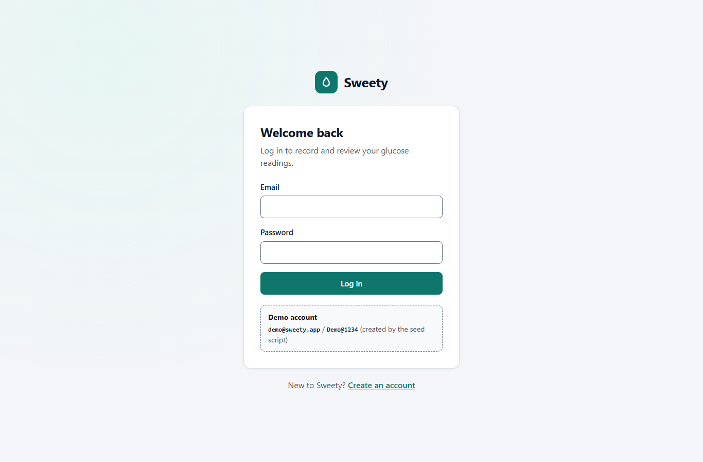 | 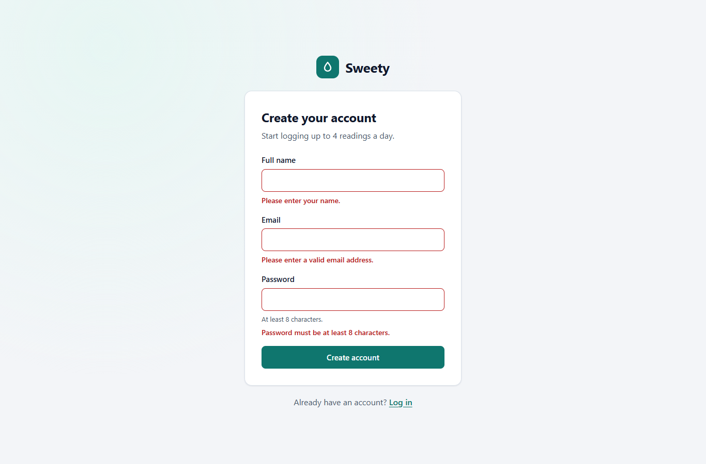 |

| Readings | Value required |
| --- | --- |
| 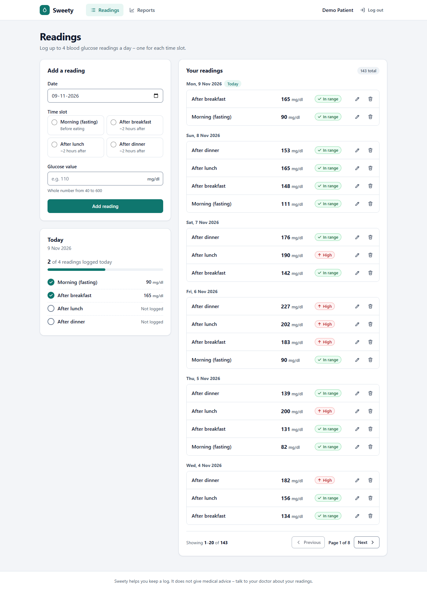 | 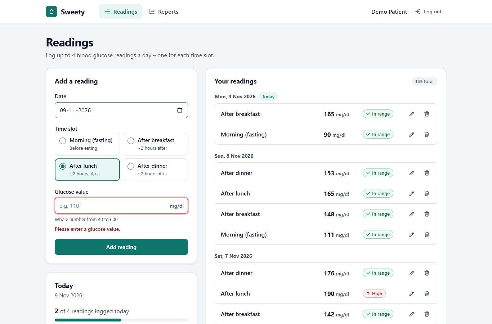 |

| Duplicate slot (from the API) | Editing a reading |
| --- | --- |
| 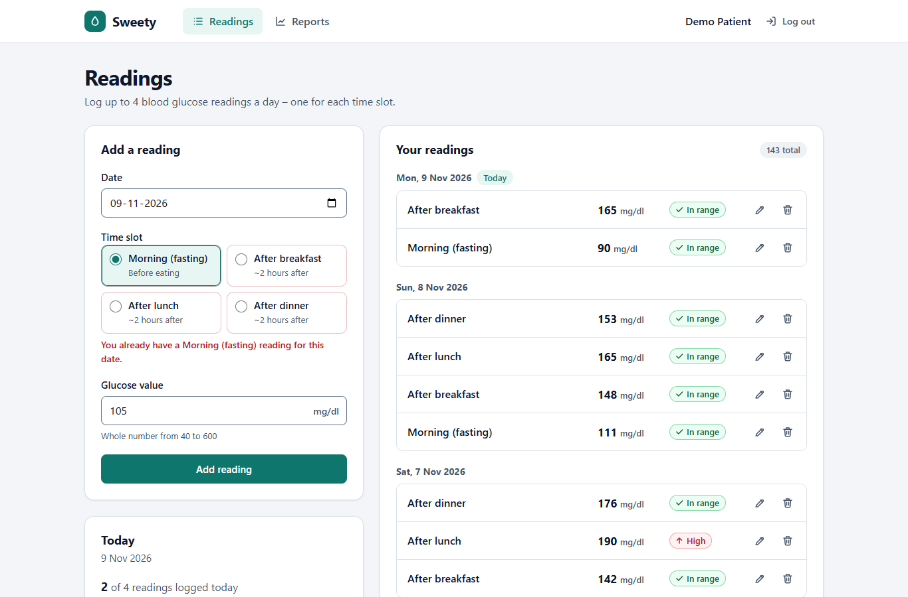 | 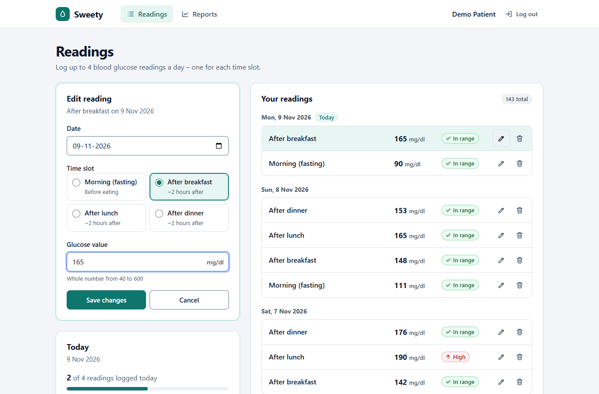 |

| Delete confirmation | Reports: empty state |
| --- | --- |
| 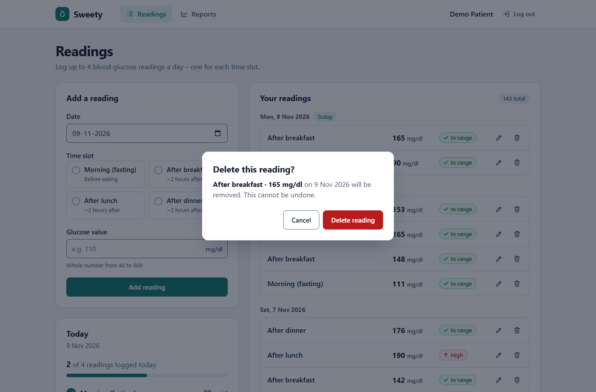 | 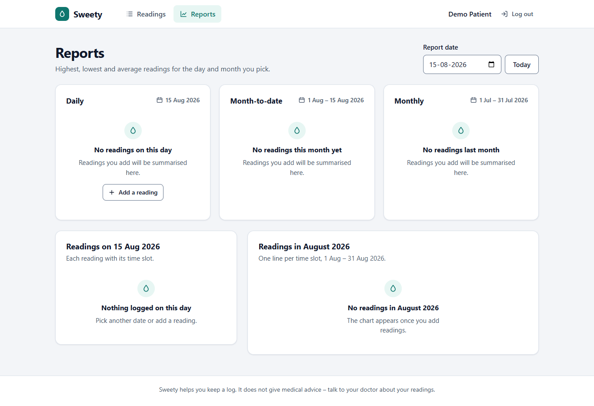 |

| Dark mode: readings | Dark mode: reports with chart tooltip |
| --- | --- |
| 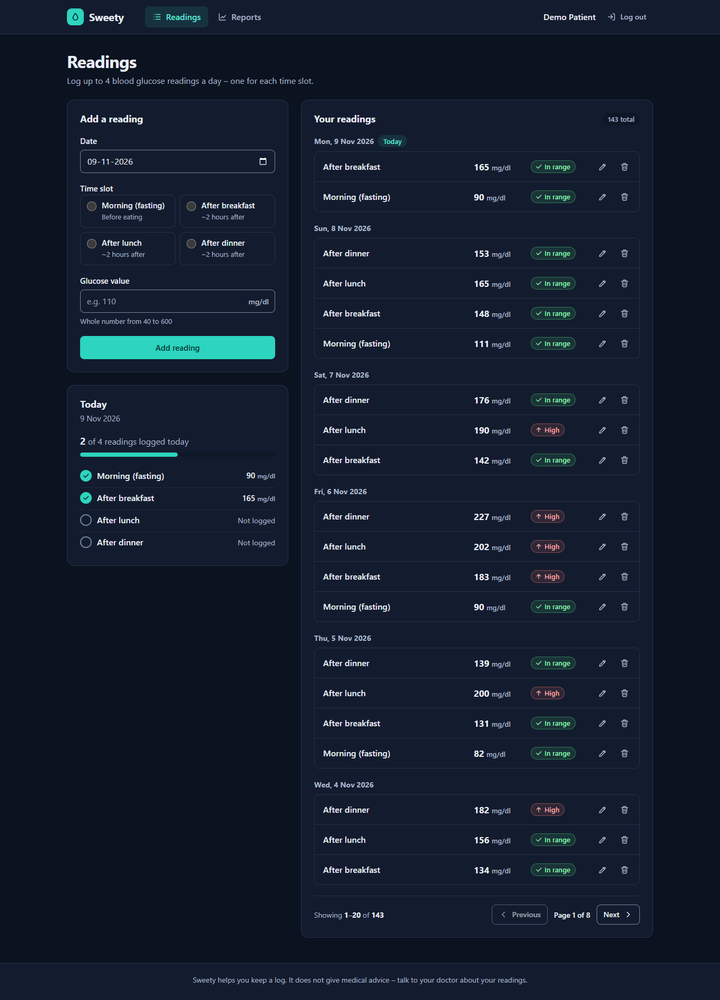 | 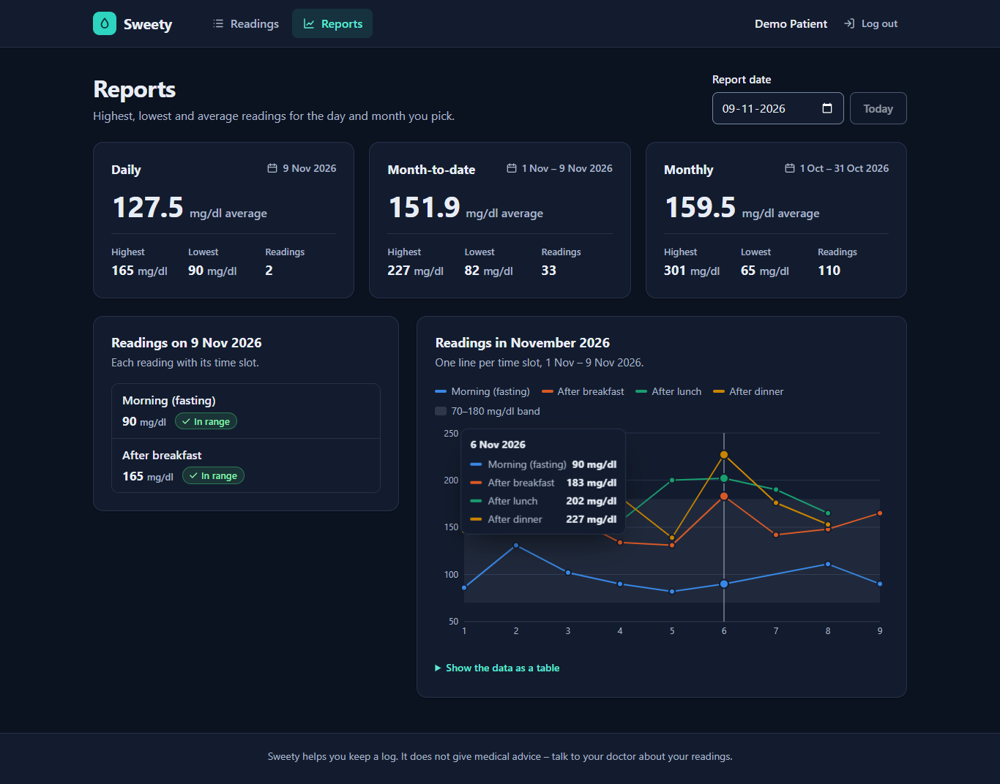 |

| Phone: readings | Phone: reports | Tablet: reports |
| --- | --- | --- |
| 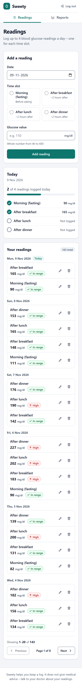 | 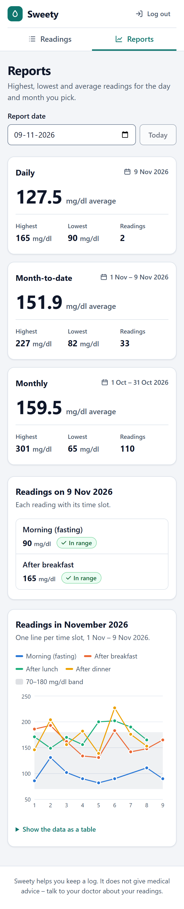 | 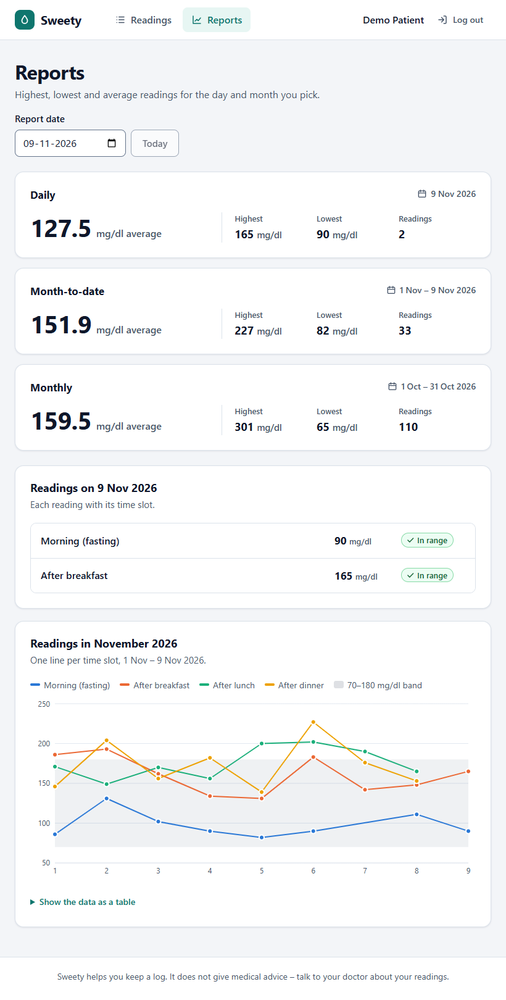 |

---

## Notes

### Assumptions

1. **Slots and the daily limit.** There are exactly 4 slots and one reading per slot, so a day can never hold more than 4 readings. Both rules are still checked, and the daily limit is checked first: when a day is full, the user sees "You can add only 4 readings per day." rather than a duplicate-slot message.
2. **What "today" means.** The API decides "today" using `APP_TIMEZONE` (default `Asia/Kolkata`), so the rule does not depend on the server's clock settings. The browser uses its own local date for the date picker. Close to midnight in a different timezone the two can disagree; the API's answer wins and its message is shown.
3. **Reports for a future date** are rejected with "Date cannot be in the future." When no date is given, reports use today.
4. **Monthly report** means the whole calendar month before the selected date's month (selected 15 Oct → 1–30 Sep), as in the assignment.
5. **Rounding.** PostgreSQL computes the average with `ROUND(AVG(value)::numeric, 1)` (half away from zero), and the UI always shows one decimal (`150.0`).
6. **Values.** Whole numbers from 40 to 600, inclusive. The API also accepts numeric strings such as `"120"`. Decimals get their own message so the user knows what went wrong.
7. **Editing** replaces date, slot and value (`PUT`). Moving a reading to another day or slot follows the same rules. The reading being edited does not count against itself.
8. **Emails** are case-insensitive (`Sam@x.com` and `sam@x.com` are the same account) and stored in lowercase.
9. **bcrypt library.** I used `bcryptjs`, a pure-JavaScript implementation of bcrypt that produces standard `$2b$` hashes. It avoids native build problems on Windows and Alpine Docker images.
10. **Login token.** The JWT is kept in `localStorage` and sent as a Bearer token. This keeps the API simple to call and test. An expired token logs the user out automatically.
11. **Low / In range / High labels** use common 70 and 180 mg/dl cut-offs. They are display-only and were not part of the brief.

### What I would improve with more time

- **Auth:** use httpOnly, SameSite cookies with refresh tokens instead of `localStorage`, plus a password reset flow and email verification.
- **Per-user timezone and units:** store each user's timezone and let them choose between mg/dl and mmol/L.
- **Richer readings:** the exact time of each reading, notes (meal, medicine, exercise), and CSV/PDF export of reports.
- **The remaining bonus tasks:** cache reports in Redis (cleared when a reading changes), a BullMQ daily reminder job, and a doctor role with patient assignment.
- **Quality:** end-to-end tests with Playwright, a GitHub Actions pipeline (lint, type-check, tests, Docker build), OpenAPI/Swagger docs and structured request logging.
- **Frontend data layer:** TanStack Query for caching and background refetching instead of the small `useAsync` hook.
